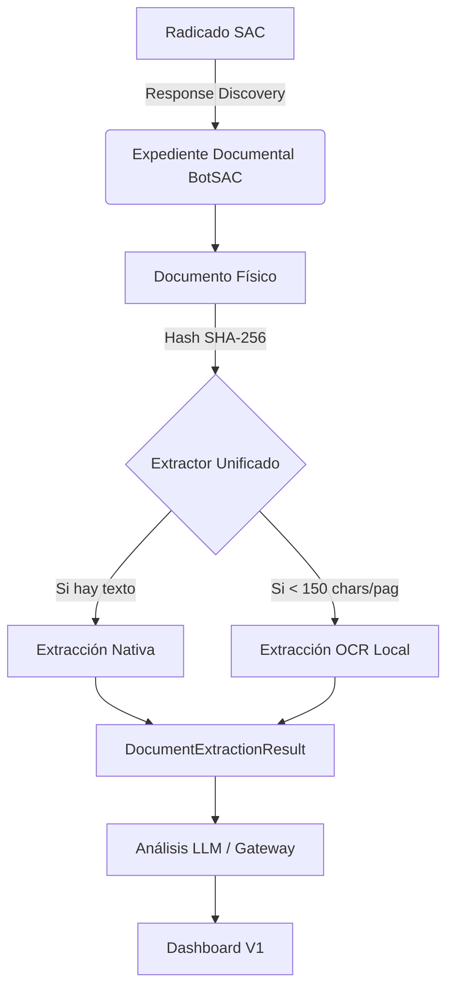

# Reconciliación BotSAC V1 vs Framework Documental SIA V2

Este informe analiza los conceptos desarrollados en el núcleo de **RobotSIA (SIA V2)** (`Automatizacion SIA`) y los contrasta con el estado actual del desarrollo de **BotSAC V1** para identificar oportunidades de reutilización, adaptación y simplificación.

## 1. Componentes SIA Relevantes Encontrados

Tras la inspección del repositorio local de SIA, se identificaron los siguientes artefactos clave en `src/v2/core/expediente/domain/` y `docs/architecture/04_DOCUMENT_EXTRACTION_SDD.md`:

*   **ExpedienteSIA**: Aggregate Root manejado mediante Event Sourcing (`ExpedienteInicializado`, `DocumentoIntegrado`).
*   **Documento (Domain Entity)**: Utiliza `hashFisico`, `storageLocator` y `tipoDocumental` para garantizar idempotencia.
*   **InventarioSnapshot**: Define reglas de completitud (documentos obligatorios y opcionales).
*   **ExtractionResult (Contrato)**: Unifica extracciones nativas, de OCR o de LLM mediante metadatos (`processingType`, `status`, `confidenceScore`), aislando el motor de extracción del dominio core.

---

## 2. Mapa de Reconciliación (SIA → BotSAC)

| Concepto SIA | Responsabilidad | Equivalente en BotSAC V1 | Reutilizable Directo | Adaptar | Descartar (V1) | Observación |
| :--- | :--- | :--- | :---: | :---: | :---: | :--- |
| **ExpedienteSIA** | Raíz de agregación y estado documental. | **Radicado** (e.g. `CAU2026...`) | NO | SÍ | NO | BotSAC opera sobre Radicados, no cuentas. Pero el concepto de "contenedor de documentos" aplica igual. |
| **Documento** | Abstracción del archivo físico. | **DocumentSource** | NO (SIA usa JS) | SÍ | NO | BotSAC usa Pydantic. Los atributos `hashFisico` y `storageLocator` son idénticos a `sha256` y rutas. |
| **ExtractionResult** | Contrato unificado de extracción de texto. | **DocumentExtraction** / **OCRExtraction** | NO | SÍ | NO | BotSAC separó la extracción en dos contratos. SIA recomienda unificarlos bajo un solo resultado. |
| **Evidencia** | Prueba anexada al expediente. | **EvidenceCheck** / **ResponseDiscovery** | NO | NO | NO | SIA la usa como archivo adjunto de auditoría. BotSAC la usa como verificación semántica y de UI. |
| **InventarioSnapshot**| Validar completitud de requisitos. | (Ninguno) | NO | NO | SÍ | BotSAC V1 solo "lee lo que hay" (Discovery), no audita si faltan documentos predefinidos. |
| **Event Sourcing** | `domainEvents` para cambios de estado. | Archivos RAW / Logs JSON | NO | NO | SÍ | BotSAC V1 es un pipeline lineal por radicado, no requiere hidratación de eventos complejos. |

---

## 3. Duplicaciones y Fricciones Detectadas

1.  **Fragmentación de la Extracción:** BotSAC está generando `DocumentExtraction` y `OCRExtraction` como dos entidades separadas (e.g., `<hash>.json` y `<hash>_ocr.json`). SIA resuelve esto elegantemente con un único `ExtractionResult` que define la procedencia (`processingType: "NATIVE" | "OCR"`), lo que facilita el consumo aguas abajo (dashboard o LLM).
2.  **Identidad Documental:** BotSAC usa `filename` repetidamente. SIA promueve el uso exclusivo del Hash (`hashFisico`) como identificador canónico para la idempotencia, previniendo duplicados si se sube el mismo PDF con nombres distintos.

---

## 4. Arquitectura Documental Mínima Propuesta (BotSAC V1)

Para mantener la simplicidad exigida para el viernes y heredar la robustez de SIA, el pipeline lineal de BotSAC debe adoptar la siguiente cadena:

---

## 5. Decisiones Concretas para el Próximo Test

**A. ¿Qué debemos CONSERVAR de BotSAC tal como está?**
*   El motor de **OCR selectivo local** (RapidOCR) y `pypdf`/`PyMuPDF`. Funcionan perfectamente, no tocan la nube y son deterministas.
*   El diseño estricto de directorios (`data/documents`, `data/analysis`, etc.).
*   La lógica de validación de `RequestAnalysis` mediante `EvidenceCheck`.

**B. ¿Qué debemos ADAPTAR para alinearlo con SIA?**
*   **Unificar los contratos Pydantic** de `DocumentExtraction` y `OCRExtraction` en un solo modelo estilo `ExtractionResult` que indique si el origen de la capa de texto fue nativo u OCR. Esto simplificará la inyección de contexto al LLM.

**C. ¿Qué código nuevo NO debemos crear?**
*   No construir un sistema de Event Sourcing ni Hidratación de Agregados. BotSAC persistirá el estado simplemente guardando/leyendo archivos JSON en disco.

**D. ¿Qué piezas de SIA NO necesitamos para esta entrega?**
*   No implementaremos `InventarioSnapshot` (no exigiremos documentos "obligatorios").
*   No se creará correlación de Cuentas ni el concepto de "Caso Multi-Radicado" por ahora.
